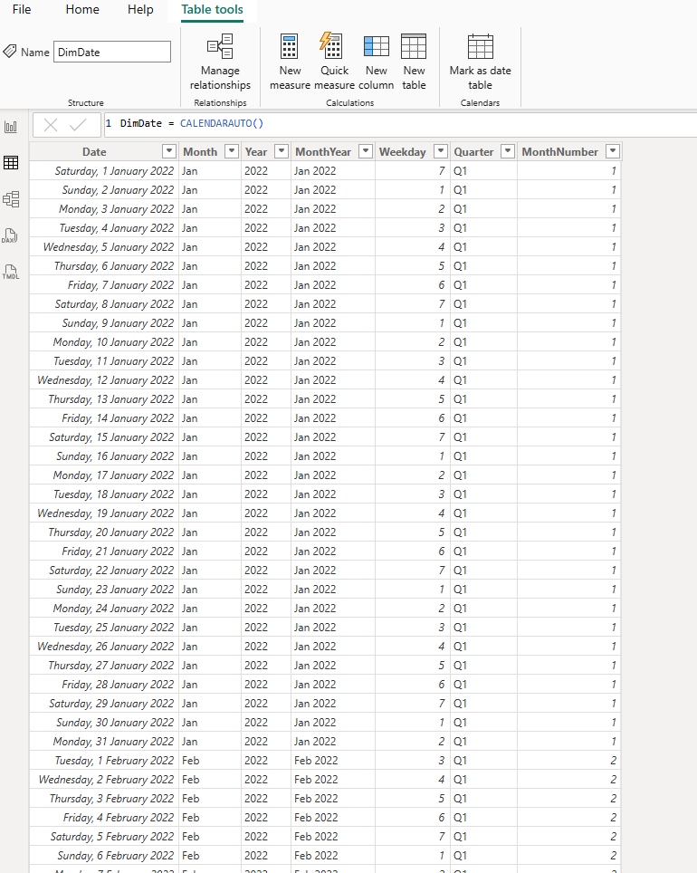
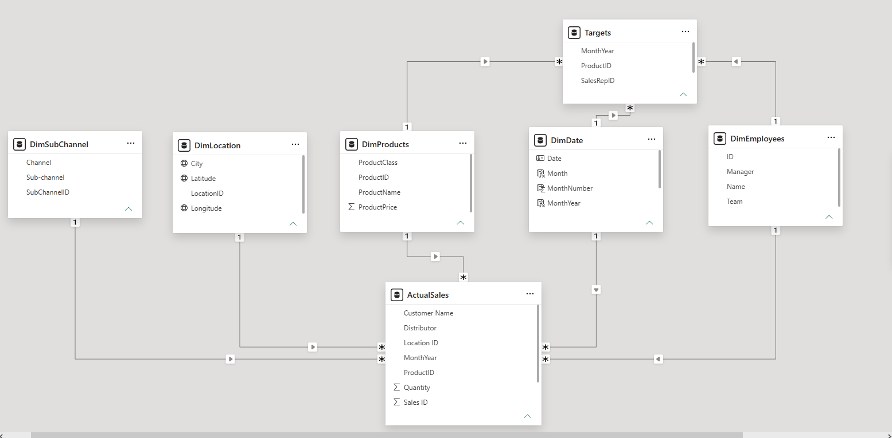
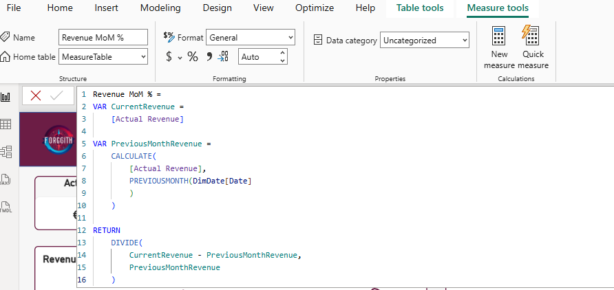
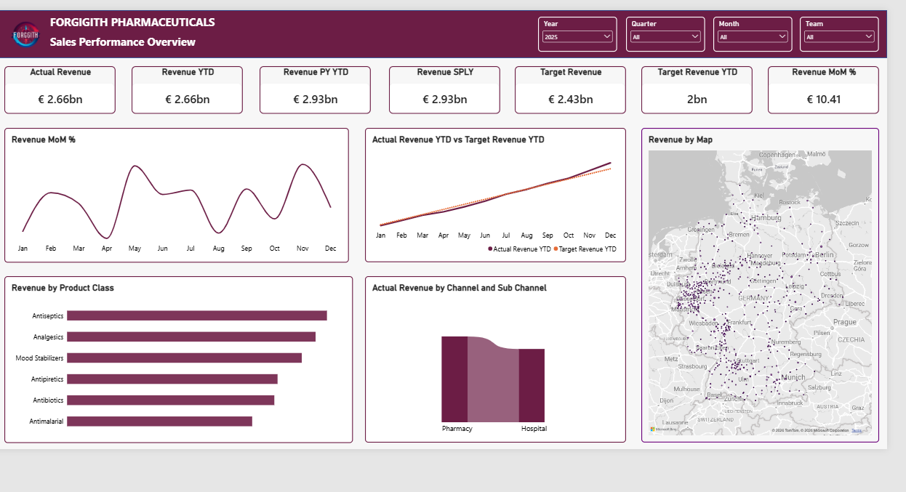
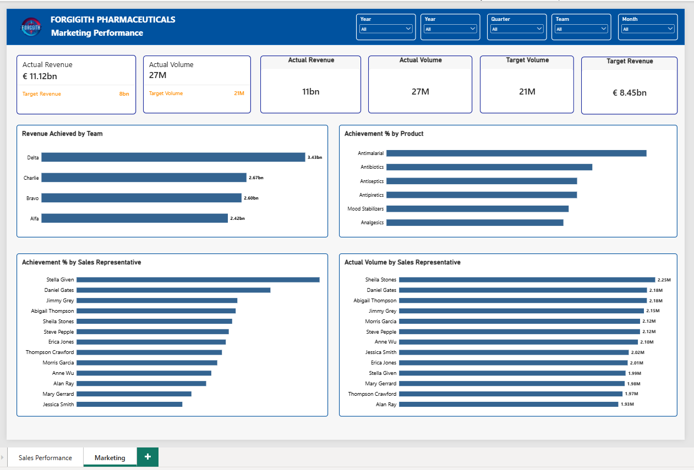
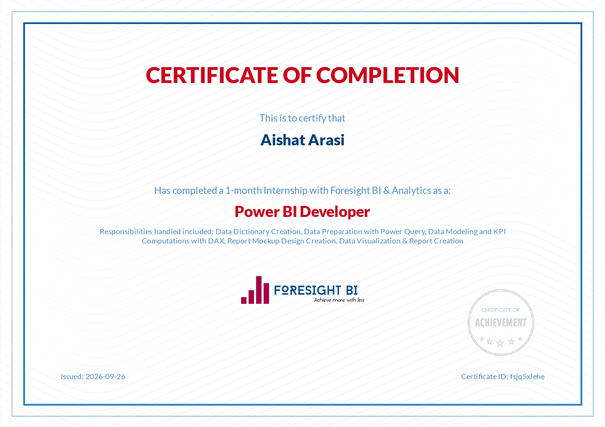

# Forggith Pharmaceuticals – Sales and Marketing Performance Analysis

##  Introduction

This project presents an analysis of sales and marketing performance at Forggith Pharmaceuticals, a pharmaceutical manufacturing company operating in Germany. The analysis uses business intelligence and data visualisation to evaluate revenue generation, sales volume, target achievement and the performance of different products, sales channels, geographical locations and sales teams.
An interactive Power BI dashboard was developed to provide management with a consolidated view of business performance. It enables users to monitor key performance indicators, compare actual results against targets, identify revenue trends and assess areas that require management attention.
The overall aim is to support informed business decisions, improve sales performance and identify opportunities for sustainable revenue growth.

##  About the Dataset

The Forggith Pharmaceuticals dataset contains business and sales information used to evaluate the company's commercial performance. It is organised into a fact table and supporting dimension tables, allowing analysis across different business areas.
The dataset covers the following areas:
-	Sales transactions: Revenue, sales volume and actual sales performance.
-	Date information: Year, quarter and month for analysing sales trends over time.
-	Product information: Product names, product classes and categories.
-	Geographical information: Cities and locations across Germany.
-	Sales channels: Hospital, Pharmacy and their respective sub-channels.
-	Employee information: Sales representatives, names and assigned teams.
-	Target information: Revenue and volume targets used to measure performance.
The data model supports comparisons between actual revenue, target revenue, previous-year performance and sales volume. It also allows management to examine performance at different levels using interactive filters.

## Problem Statement

Forggith Pharmaceuticals needs a comprehensive reporting system to monitor its sales and marketing performance. Without a consolidated view of revenue, sales targets, product performance and sales team contributions, management may find it difficult to identify performance gaps and make timely business decisions.
The analysis seeks to address the following business questions:
1.	How much revenue has the company generated, and how does it compare with previous periods?
2.	Is the company achieving its revenue and sales volume targets?
3.	How does revenue change monthly and quarterly?
4.	Which product classes contribute the most to total revenue?
5.	Which cities and sales channels generate the highest revenue?
6.	How do individual sales representatives and teams perform against their targets?
7.	Which products and sales representatives have the lowest target achievement?
8.	What areas require attention to improve overall sales performance?
The objective is to transform the available business data into meaningful insights that support performance monitoring, resource allocation and strategic planning.

## Visualization and Tools Used

-	Microsoft Power BI
-	Power Query
-	DAX
-	Data Modelling
-	Data Visualisation

### DATE TABLE
Created a dim date using CalendarAuto

### Data Modelling
The star schema was used for the relationship
- dim_date, dim_subChannel, dim_products, dim_employees, dim_location - Fact_ActualSales (One to Many Relationship)
- dim_date, dim_employees, dim_location - Fact_Target (One to Many Relationship)

### DAX 

.png)

### The Sales Dashboard

### The Target Dashboard

## Key Insights

The analysis revealed the following findings:
1. Strong Revenue Performance:
-	The company generated approximately €2.83 billion in total revenue.
-	Revenue year-to-date reached €2.83 billion, compared with €2.70 billion in the previous year-to-date period.
-	Year-on-year revenue growth was approximately 22.96%.
-	Month-on-month revenue growth stood at 3.4% on the executive dashboard mockup.
This indicates positive revenue performance compared with the previous year.
2. Revenue Exceeded the Set Target:
-	Actual revenue reached approximately €2.83 billion against a target of €2.00 billion.
-	Revenue target achievement stood at 141%.
-	This means the company generated approximately 41% more revenue than its target.
The result indicates that overall revenue performance was above the established target.
3. Sales Volume Performance:
-	Actual sales volume reached approximately 6.81 million units.
-	The target sales volume was approximately 4.86 million units.
This represents sales volume achievement of approximately 140%, showing that actual unit sales exceeded the planned target.
4. Sales Channel Performance:
The dashboard provides a comparison of revenue generated through the Hospital and Pharmacy channels, including their respective sub-channels.
This helps management understand how different distribution channels contribute to overall revenue and identify opportunities to strengthen lower-performing channels.
5. Product Class Performance:
The product analysis covers six product classes:
-	Analgesics
-	Antibiotics
-	Antiseptics
-	Mood Stabilizers
-	Antimalarial
-	Antipyretics
This breakdown allows management to identify the product classes contributing most to revenue and assess the distribution of sales across the pharmaceutical portfolio.
6. Geographical Revenue Distribution:
The geographical analysis examines revenue generated across different German cities.
The map visualisation helps management identify locations with stronger revenue contributions and areas that may require additional sales attention.
7. Sales Representative Performance:
The marketing dashboard compares sales representatives based on actual revenue, sales volume and target achievement.
The available dashboard mockup shows differences in individual performance, with some representatives exceeding their revenue targets while others fall below them.
For example, one representative achieved 87% of the revenue target, while another achieved 121%.
This provides a basis for evaluating team performance and identifying where additional support may be needed.
8. Products with Low Target Achievement:
The dashboard also highlights the bottom ten products by achievement percentage.
This allows management to identify products with weaker sales performance and investigate possible reasons, such as customer demand, product availability, pricing or distribution challenges.

## Further Recommendations
Based on the analysis, the following actions are recommended:
1. Strengthen underperforming sales areas: Investigate cities and sales channels with lower revenue contributions and develop strategies to improve market coverage.
2. Review product performance: Examine products with low target achievement to identify possible issues affecting sales. Adjust marketing and distribution strategies where necessary.
3. Maintain strong sales performance: Recognise high-performing sales representatives and identify the practices contributing to their results. These practices can inform team-wide performance improvement.
4. Improve sales representative support: Provide additional training, coaching and performance monitoring for representatives who consistently fall below their targets.
5. Monitor revenue trends: Review monthly and quarterly revenue performance to identify fluctuations early and adjust sales strategies accordingly.
6. Improve product distribution: Ensure that products with strong demand are adequately supplied across relevant distribution channels and geographical locations.
7. Review sales targets regularly: Use historical performance and market demand to establish realistic but challenging revenue and volume targets.
8. Strengthen performance monitoring: Use the interactive Power BI dashboard during regular management reviews to track progress and evaluate the effectiveness of implemented strategies.

## Conclusion
The analysis of Forggith Pharmaceuticals' sales and marketing performance provides an overview of the company's revenue generation, sales volume, target achievement and distribution performance.
The findings show that the company generated approximately €2.83 billion in revenue, achieving 141% of its revenue target. Sales volume also exceeded its target, indicating positive overall commercial performance.
However, differences in product performance, geographical revenue contributions and individual sales representative achievements provide opportunities for further improvement.
By using the insights from the Power BI dashboard, management can strengthen sales strategies, improve the performance of underperforming products and teams, and make better-informed decisions regarding resource allocation and market development.

## Certification

